## About

I'm a Mobile Software Engineer specializing in Flutter. For the past couple of
years I've been building apps for Android and iOS and getting them onto Google
Play and the App Store. I like owning an app end to end, from how it's
architected down to the day it ships, and I care about clean architecture and
real-time features.

Right now I'm a Flutter developer at Gosor Solution. I also teach Flutter in
Arabic on my YouTube channel.

## Selected work

<table>
<tr>
<td width="33%" valign="top">

**EraaSoft** 
Student LMS for courses, enrollment and assignments. Feature modules over a
repository layer, one network layer for auth and errors, push notifications
that open the right screen.

[Google Play](https://play.google.com/store/apps/details?id=com.eraasoft.gosor)

</td>
<td width="33%" valign="top">

**Pact** 
Real-time accountability app for paired partners on Firebase. One user can
run several independent partnerships, with invite codes that can't be guessed.

[Google Play](https://play.google.com/store/apps/details?id=com.anas.pact)

</td>
<td width="33%" valign="top">

**PennyTrack** 
Offline personal finance tracker with budgets, reports and CSV export. CI runs
analysis and tests on every push before a release bundle is built.

Private repo

</td>
</tr>
</table>

## Open source

- [bookia](https://github.com/Anas3Ezz/bookia): e-commerce bookstore app with Clean Architecture, Bloc/Cubit, REST APIs and Freezed
- [taskati](https://github.com/Anas3Ezz/taskati): offline task manager using Hive

## Toolbox

Clean Architecture, BLoC/Cubit, Dio and REST APIs, Hive, Freezed, unit testing, Google Play publishing

